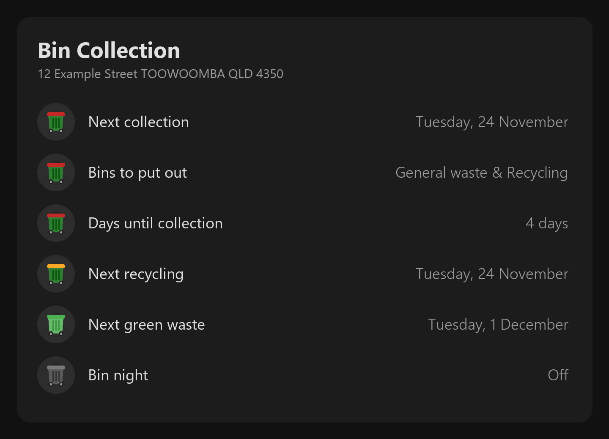

<p align="center">
  
</p>

<h1 align="center">Bin Collection Toowoomba QLD</h1>

<p align="center">
  <a href="https://my.home-assistant.io/redirect/hacs_repository/?owner=4Sayken&repository=bin-collection-toowoomba-qld&category=integration"></a>
  <a href="https://github.com/4Sayken/bin-collection-toowoomba-qld/releases"></a>
  <a href="https://github.com/4Sayken/bin-collection-toowoomba-qld/actions/workflows/validate.yml"></a>
  <a href="LICENSE"></a>
  <br>
  <a href="https://github.com/4Sayken/bin-collection-toowoomba-qld/commits/main"></a>
  
</p>

<p align="center"><em>Know which bins go out, and when, for any property in the Toowoomba Region, right inside Home Assistant.</em></p>

---

<p align="center">
  
</p>

## ✨ What it does

Toowoomba Regional Council's
[Find your bin day](https://www.tr.qld.gov.au/Waste-and-water/Waste-and-recycling/Your-waste-bins-%e2%80%93-general-recycling-and-green-waste#section-2)
tool tells you this week's collection. This integration does the same lookup for
you once a month (or whenever you press a button) and turns it into sensors you
can put on a dashboard or use in automations:

- 📅 **When** the next collection is, and how many days away.
- 🗑️ **Which bins** go out: general waste plus recycling or green waste.
- ♻️ **The next recycling date** and 🌿 **the next green waste date**.
- 🌙 **A "Bin night" sensor** that's on the day before collection, for reminders.
- 🔍 **A "Check for changes" button** that checks the council's site straight away
  and tells you if your collection has changed.

## 🚀 Get Started

> **HACS or Marketplace?** They're the same thing. Since **Home Assistant 2026.11**,
> HACS (the Home Assistant Community Store) is built into Home Assistant as the
> **Marketplace**, under **Settings → Marketplace**. On older versions (2025.3 to
> 2026.10) you install HACS separately. Follow the steps for your version below.

**Add it to Home Assistant through the Marketplace or, before 2026.11, HACS:**

[](https://my.home-assistant.io/redirect/hacs_repository/?owner=4Sayken&repository=bin-collection-toowoomba-qld&category=integration)

The button above opens this repository in your Home Assistant. To do it by hand:

**Home Assistant 2026.11 or newer (Marketplace)**

1. Open **Settings → Marketplace** and accept its first-run warning if asked.
2. Connect your GitHub account when prompted; the Marketplace needs it for custom repositories.
3. Open the menu (⋮) → **Custom repositories**, add
   `https://github.com/4Sayken/bin-collection-toowoomba-qld` with the type **Integration**.
4. Search for **Bin Collection Toowoomba QLD**, select **Install**, then restart Home Assistant.

**Home Assistant 2025.3 to 2026.10 (HACS)**

1. In **HACS**, open the menu (⋮) → **Custom repositories**.
2. Add `https://github.com/4Sayken/bin-collection-toowoomba-qld` with the type **Integration**.
3. Search for **Bin Collection Toowoomba QLD**, select **Download**, then restart Home Assistant.

**Manual install (no Marketplace or HACS):** copy
`custom_components/bin_collection_toowoomba_qld` into your Home Assistant
`config/custom_components` folder and restart.

### Add your property

[](https://my.home-assistant.io/redirect/config_flow_start/?domain=bin_collection_toowoomba_qld)

1. Go to **Settings → Devices & services → Add integration** and pick
   **Bin Collection Toowoomba QLD**.
2. Type the start of your street address, for example `12 Example`.
3. Pick your property from the council's list.

You can add several properties; each becomes its own device.

## 🗑️ Entities

| Entity | Type | What it shows |
| --- | --- | --- |
| Next collection | Sensor (date) | The next collection day |
| Bins to put out | Sensor | Which bins go out at the next collection, e.g. `General waste & Recycling` |
| Days until collection | Sensor | Days until the next collection (0 on the day) |
| Next recycling | Sensor (date) | The next day recycling (yellow lid) is collected |
| Next green waste | Sensor (date) | The next day green waste (green lid) is collected; unknown until the integration has seen green waste for your property |
| Recycling week | Binary sensor | On when recycling goes out at the next collection |
| Green waste week | Binary sensor | On when green waste goes out at the next collection |
| Bin night | Binary sensor | On the day before collection (the council asks for bins out the night before); off at midnight |
| Check for changes | Button | Checks the council's site now; see [How often it checks](#-how-often-it-checks) |
| Last checked | Sensor (timestamp, diagnostic) | When the council's site was last checked successfully |
| Last changed | Sensor (timestamp, diagnostic) | When a check last found the next collection different from what was expected |

The **Next collection** sensor also has attributes for each bin, the council's
own wording, and the bin image the council shows.

## 🧮 How the next collection is worked out

The council's tool shows *this week's* collection, even after that day has
passed. Once it has, this integration rolls the date forward a week and swaps
recycling and green waste, since they alternate fortnightly. While a date is
rolled forward like this, the `estimated` attribute is `true`. It's `false` only
while the saved reading is itself the upcoming collection, which with monthly
checks is mostly just after a check.

Green waste is an optional council service. The integration remembers once it
has seen green waste for your property, so if you set it up during a recycling
week, green waste dates are only predicted after the council shows one.

## 🔄 How often it checks

The integration checks the council's site **once a month, early on the 1st**
(each property at its own minute between 4 and 5 am, so installs don't all hit
the council at once). The reading is saved, so restarting Home Assistant doesn't
trigger another check. Between checks, the saved reading is rolled forward each
day just after midnight, without contacting the council.

If a monthly check fails (or Home Assistant was off on the 1st), the integration
keeps using the saved reading and tries again each day until a check succeeds
that month.

Because collections alternate fortnightly, the prediction stays right unless the
council changes something, such as a public holiday shift. To check sooner,
press **Check for changes** on the property's device page (or call
`button.press` from an automation). It checks the council's site straight away
and, if the next collection is different from what the integration expected,
shows a notification in Home Assistant naming the property and what changed.
If nothing changed, it updates **Last checked** quietly.

Each property you add has its own saved reading, button and notifications.

## 🤖 Example automation

A reminder at 6 pm on bin night:

```yaml
automation:
  - alias: Bin night reminder
    triggers:
      - trigger: time
        at: "18:00:00"
    conditions:
      - condition: state
        entity_id: binary_sensor.12_example_street_toowoomba_qld_4350_bin_night
        state: "on"
    actions:
      - action: notify.notify
        data:
          title: Bin night
          message: >
            Put out: {{ states('sensor.12_example_street_toowoomba_qld_4350_bins_to_put_out') }}
```

Your entity IDs will match your own address.

## ⚠️ Disclaimer

This project isn't affiliated with or endorsed by Toowoomba Regional Council. It
relies on the council's public website, which may change without notice.
